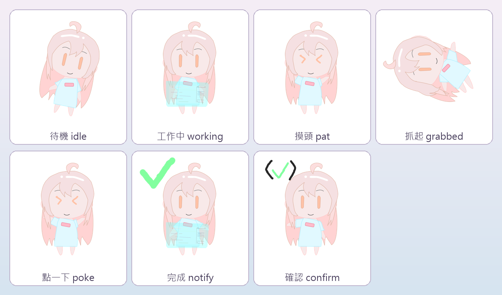
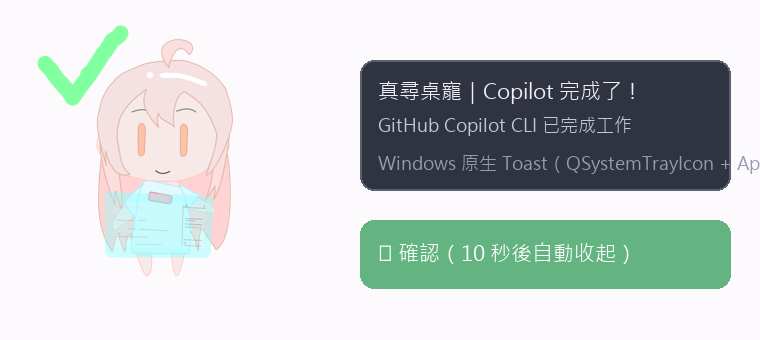

# Mahiro Desktop Pet — Windows 版（真尋桌寵）

一個在你桌面上陪你寫 code 的 PyQt6 桌寵，會監聽 GitHub Copilot CLI 的執行狀態，
自動切換動畫並送出系統通知。

本倉庫是 [Ruixue9626/mahiro_pet](https://github.com/Ruixue9626/mahiro_pet)（Linux 版）
的 **Windows 移植版**：原始互動、動畫與素材完全沿用，另外加上 Windows 原生通知、
開機自動啟動、滑鼠穿透、單實例保護與多螢幕／DPI 正確定位，
同時**保留原本在 Linux 上的行為**（同一份程式碼兩邊都能跑）。


七種動畫狀態一覽（每個狀態取其中一幀）：



* * *

## 作者與授權

| | |
|---|---|
| **原始作者 / Original author** | [Ruixue9626](https://github.com/Ruixue9626) — [mahiro_pet](https://github.com/Ruixue9626/mahiro_pet)（Linux 版、角色設計與動畫素材） |
| **Windows 移植 / Windows port** | [1NotAmon（阿孟Amon）](https://github.com/1NotAmon) |
| **授權 / License** | [MIT](LICENSE)（沿用上游授權，兩段版權聲明一併保留） |

角色與素材版權屬於原作者，移植版只做程式碼適配。

* * *

## Features

* 監聽 `copilot` 指令執行狀態，自動切換動畫、完成時通知
* 多種互動：點一下、摸頭、抓起來拖著走、右鍵選單
* **跨平台**：Windows 10 / 11、Linux（X11）、macOS（順帶可用）
* **Windows 原生通知**（Toast）+ 完成提示音，不需要任何額外套件
* **開機自動啟動**、**滑鼠穿透**（桌寵不擋你點桌面）
* **多螢幕 / DPI 縮放正確定位**，不會被工作列擋住、也不會被拖到螢幕外消失
* **單實例保護**：雙擊兩次不會冒出兩隻桌寵
* **背景載入動畫幀**：0.4 秒就出現桌寵，不用等兩三千張圖片解碼
* 支援自訂動畫幀圖片（PNG / JPG / WebP），換圖後右鍵即可「重新載入素材」
* 所有參數可用 `settings.json` 覆寫，不用改程式碼

* * *

## Requirements

* Windows 10 / 11（或其他桌面系統）、**64 位元** Python 3.10 以上
  * 需要能裝 `PyQt6`（PyQt6 的 wheel 是 `cp310-abi3`，3.10 ~ 3.15 都可用）
* GitHub Copilot CLI（選配：沒有裝也能用，只是不會自動偵測工作狀態）

    ```powershell
    winget install GitHub.Copilot          # Windows
    ```

    ```bash
    curl -fsSL https://raw.githubusercontent.com/github/copilot-cli/main/scripts/install.sh | bash   # Linux
    ```

* Linux 端需要支援 `xcb` 的桌面環境（原版設定沿用）

* * *

## Quick Start

### Windows

```powershell
# 1. Clone
git clone https://github.com/1NotAmon/mahiro_pet_windows.git
cd mahiro_pet_windows

# 2. 一鍵安裝 + 啟動（自動建立 .venv、裝 PyQt6 / psutil / Pillow）
powershell -ExecutionPolicy Bypass -File setup.ps1
```

之後日常啟動只要**雙擊 `啟動桌寵.bat`**（不會出現黑色終端機視窗）。
需要看 log 就用 `啟動桌寵_除錯模式.bat`（會先印環境資訊再啟動）。

> `setup.ps1` 會自動尋找 64 位元的 Python 3.10+；找不到時會提示
> `winget install Python.Python.3.12`，也可以自行指定：
> `setup.ps1 -Python "C:\Python312\python.exe"`。

### Linux

```bash
git clone https://github.com/1NotAmon/mahiro_pet_windows.git
cd mahiro_pet_windows
bash setup.sh          # 一鍵建立虛擬環境、安裝依賴並啟動
# 之後：
source .venv/bin/activate && python3 main.py
```

### 檢查環境是否 OK

```bash
python main.py --info          # Python / Qt / copilot 路徑 / 系統匣 / 開機自啟狀態
python main.py --test-notify   # 發一條測試通知，驗證系統通知鏈路
```

* * *

## Interactions

| 互動 | 觸發方式 |
|---|---|
| 點一下 | 快速點擊（< 250ms） |
| 摸頭 | 按住 250 ~ 800ms 後放開 |
| 抓起來 | 按住 > 800ms，可以拖著走 |
| 右鍵選單 | 右鍵點桌寵或系統匣圖示 |
| 確認按鈕 | Copilot 完成後出現，點一下確認 |
| 拖曳移動 | 按住後移動滑鼠 |

系統匣 / 右鍵選單：**顯示隱藏**、**滑鼠穿透**、**開機自動啟動**、
**模擬一次完成通知**（沒有跑 copilot 也能測）、**重新載入素材**、**結束**。



* * *

## Configuration（settings.json）

把 `settings.json.example` 複製成 `settings.json`，只寫想改的欄位即可。

```json
{
  "pet_size": [240, 240],
  "animation_fps": { "idle": 6, "working": 12 },
  "watcher": { "poll_interval": 0.5 }
}
```

| 欄位 | 預設 | 說明 |
|---|---|---|
| `pet_size` | `[240, 240]` | 顯示尺寸；螢幕縮放 150% 覺得太大可以調小 |
| `auto_trim` | `false` | `true` 依 alpha 自動裁掉素材四周透明邊（人物視覺大小不變，視窗比較不擋桌面） |
| `animation_fps` | 見 `animation.py` | 逐狀態覆寫 FPS |
| `poke_max_ms` / `pat_max_ms` / `grab_ms` | 250 / 800 / 800 | 互動判定門檻 |
| `confirm_auto_hide_ms` | 10000 | 確認按鈕多久自動收起 |
| `watcher.poll_interval` | 0.5 | 偵測 copilot 的間隔秒數 |
| `watcher.copilot_path` | 自動尋找 | copilot 不在 PATH 時直接指定完整路徑 |
| `watcher.extra_process_names` | `[]` | 這些程序出現也算「工作中」，例 `["node.exe"]` |
| `notify_sound` | `true` | Windows 完成時播放系統提示音 |
| `start_hidden` | `false` | 啟動時只躲系統匣 |
| `click_through` | `false` | 滑鼠穿透模式 |

其他：`pet_window.py` 上方有互動閾值常數、`animation.py` 有 `ANIM_CONFIG`（FPS／循環／播完接哪個狀態），
不改 settings.json 也能直接调。

* * *

## 命令列參數

```bash
python main.py                  # 正常啟動
python main.py --hidden         # 這次啟動不顯示桌寵
python main.py --info           # 環境診斷
python main.py --test-notify    # 測試系統通知
python main.py --autostart on   # 開機自動啟動（Windows 寫 HKCU\...\Run；Linux 寫 .desktop）
python main.py --autostart off  # 取消
```

* * *

## Adding Your Sprites

將動畫幀圖片放進 `assets/` 對應的資料夾，命名用數字排序（`001.png`、`002.png`、…）：

```
assets/
├── idle/        # 待機（循環播放）
├── working/     # Copilot 工作中（循環播放）
├── pat/         # 摸頭（播完回 idle）
├── grabbed/     # 被抓起來（循環，直到放下）
├── poke/        # 點一下（播完回 idle）
├── notify/      # 完成通知（播完顯示確認按鈕）
└── confirm/     # 點確認按鈕（播完回 idle）
```

支援格式：`.png` `.jpg` `.webp`。幀檔以**數字自然排序**（`010` 不會排在 `002` 前面）。

> 沒有放圖片也沒關係，會自動用內建彩色圓圈代替。
> 換完圖片不用重啟：右鍵 →「重新載入素材」。

* * *

## Dependencies

| 套件 | 用途 | 備註 |
|---|---|---|
| `PyQt6` | UI 框架與視窗管理 | 必需 |
| `psutil` | 監聽 copilot 程序 | 必需 |
| `Pillow` | 分析素材 alpha（`auto_trim`） | 選配，沒裝只是不會裁剪 |
| `plyer` | 系統通知 fallback | 只在非 Windows 安裝；Windows 走系統匣原生 Toast |

* * *

## 移植過程：Linux → Windows

移植的原則：**平台差異全部集中到 `platform_utils.py` 與 `config.py`**，
其他模組只問這兩個檔案，不直接判斷 OS；因此 Linux 分支的行為保持原樣。
下面每一條都是實際踩到、且在 Windows 上驗證過的問題。

### 1. Qt 平台插件：`xcb` 硬塞會直接啟動失敗

原本 `main.py` 無條件執行

```python
os.environ.setdefault("QT_QPA_PLATFORM", "xcb")
```

Windows 上沒有 `xcb` 插件，結果是 `could not load platform plugin "xcb"`，
連視窗都出不來。改成只在 Linux 設定：

```python
if IS_LINUX:
    os.environ.setdefault("QT_QPA_PLATFORM", "xcb")
```

### 2. 通知：`notify-send` 不存在，plyer 在 Windows 11 又不靠譜

`notifier.py` 優先呼叫 `notify-send`（Linux 專用）。Windows 上它不存在，
而 plyer 的 Windows 實作依赖舊的 `Shell_NotifyIcon` 包裝，在新 Python／Win11 上常直接失敗。

做法是改成**用桌寵自己的系統匣發通知**（`QSystemTrayIcon.showMessage()`，
Windows 10/11 會顯示成原生 Toast，零额外套件），並在建立 `QApplication` 之前註冊
`AppUserModelID`：

```python
ctypes.windll.shell32.SetCurrentProcessExplicitAppUserModelID("com.zhenxun.desktoppet")
```

**沒有這個 AUMID，Windows 的 Toast 通知根本不會彈出來**（或標題顯示成 `python.exe`），
這點卡了很久。顺序變成：系統匣 → `notify-send`(Linux) → `osascript`(macOS) → plyer → stderr。

### 3. X11 限定旗標與焦點搶奪

`dialog_bubble.py` 用了 `Qt.WindowType.X11BypassWindowManagerHint`——這在 Windows 上無意義。
現在只在 Linux 加上它，Windows 端改補 `WindowDoesNotAcceptFocus`，
讓氣泡出現時**不會把焦點從你正在打的終端機搶走**。

### 4. 定位：被工作列擋住、被拖到螢幕外就再也抓不回來

原本放在右上角再減固定邊界：

```python
self.move(screen.width() - self.width() - 40,
          screen.height() - self.height() - 60)
```

Windows 工作列高度不固定（還會自動隱藏／靠左右），DPI 縮放後 `geometry()` 是邏輯像素，
桌寵常出現「半截被工作列蓋住」或拖出去之後找不到。改成：

* 一律使用**所在螢幕**的 `availableGeometry()`（多螢幕以桌寵實際那一隻為準）
* 每次拖曳結束、以及解析度／DPI 變更（`DevicePixelRatioChange`）後 `clamp` 回工作區內
* 如果整隻視窗已經在桌面範圍外（例如拔掉副螢幕），自動拉回主螢幕右下角

### 5. 程序偵測：誤判、大小寫、與 3.2 秒的掃描

這一塊改得最多，也最容易出錯。

* **Windows 11 內建的 Copilot 造成永久誤判。** 實測機器上有 11 個 `copilotapp.exe`
  常駐程序，另有 `copilot-runtime.exe`。如果沿用「程序名稱含有 `copilot` 就當成在跑」
  這種直覺規則，桌寵會**永久顯示成「Copilot 工作中」**，动畫永远卡在 working。
  → 改為程序名**完整比對** + 執行檔**實路徑比對**，並把內建 Copilot App 列進排除清單。
* **大小寫。** 本機 PATH 解析出來的其實是 `copilot.EXE`，比對一律走
  `os.path.normcase(os.path.realpath(...))`（同時也能應付 8.3 短檔名與符號連結）。
* **掃描成本高達 3210ms／次。** 原因很隱蔽：`psutil` 在 Windows 上取 `status` 屬性時
  會呼叫 `proc_is_suspended`，350 個程序要 2.3 秒；而原本過濾殭屍程序用的
  `getattr(psutil, "STATUS_ZOMBIE", None)` 在 Windows **也會拿到值**（常數是跨平台定義的），
  所以「用 getattr 判斷平台」根本無效，等於每次都多要了 `status`。
  → Windows 改用 `CreateToolhelp32Snapshot` 拿 `(pid, 名稱)`，名稱沒命中就結束這一輪，
  只有命中才用 psutil 解析 `exe()`。實測 **3210ms → 12.6ms（約 250 倍）**，
  0.5 秒一次的輪詢只占單核約 2.5%。
* npm 安装的 copilot 其實是 `copilot.cmd` 叫 `node.exe` 跑 script，
  因此**只有**在偵測目標不是 `.exe` 時才會去檢查 `node.exe` 的 command line，
  避免平白多出昂貴的掃描。

### 6. 啟動速度：3.5 秒才看到桌寵

90 張 1024×1024 PNG 全部在主執行緒同步解碼，Windows 實測要 3.5 秒。
改成先同步載入 `idle`（立刻有東西可顯示），其餘狀態丢給背景執行緒：

* 背景執行緒只用 `QImage`（跨執行緒安全），`QPixmap` 一律在**主執行緒**轉換
* 每個狀態完成就發訊號回報，避免一次卡住整個 UI

同時多了一個必須處理的邊角：**幀還沒載入完就觸發非循環動畫**（例如一開機就戳牠），
會被當成「只有 1 幀而且不循環」而立刻跳回 idle。
現在載入中的狀態會先撐住佔位圖，幀到了再從第一幀開始播。

實測：`PetWindow` 建立 **0.38 秒**、idle 立即可見，六個狀態 2.67 秒內全部就緒。

### 7. 單實例保護

雙擊兩次 `啟動桌寵.bat` 會跑出兩隻桌寵（Linux 上比較少見，Windows 很常）。
Windows 用 `CreateMutexW`、Linux/macOS 用 `flock` lock file；第二個實例彈提示後自行結束。

### 8. 主控台編碼：print 中文會 crash

Windows 主控台預設用 OEM 編碼（繁中環境是 Big5/cp950），
`print` 中文或 emoji 會 `UnicodeEncodeError` 把程式弄挂。
啟動時統一 `sys.stdout.reconfigure(encoding="utf-8", errors="replace")`，
`--info` 這类診斷輸出才能安全地印中文。

### 9. 安装與啟動

* 新增 `setup.ps1`：自動找 **64 位元** Python 3.10+（PyQt6 沒有 32-bit wheel）、
  建立 `.venv`、依 `requirements.txt` 安裝、確認 `assets/` 资料夾齊全，然後啟動。
  冪等：已經裝過就跳過安裝直接啟動，`-ForceReinstall` 可重建。
* 新增 `啟動桌寵.bat`（用 `pythonw.exe` 啟動，不出現終端機）
  與 `啟動桌寵_除錯模式.bat`（保留終端機與 log）。
* `requirements.txt` 改用環境標記：`plyer>=2.1.0 ; sys_platform != "win32"`，
  Windows 不再被迫安裝用不上的套件。
* 新增 `settings.json.example`：Windows 使用者調尺寸、FPS、copilot 路徑不用改程式碼。

### 10. 順帶修掉一個原版就存在的 bug

`AnimationController` 建立時 `current_state` 已經是 `idle`，而

```python
self._anim.set_state(AnimState.IDLE)   # 狀態相同 → 直接 return
```

**第一幀從未送出、計時器也沒有啟動**，結果桌寵是完全透明、看不到的
（`set_state` 是唯一會啟動計時器的地方）。這個 bug 在 Linux 原版同樣存在。
修正方式是用 `set_state(AnimState.IDLE, force=True)`。

### 移植前後量測對照

| 項目 | Linux 版在 Windows 上 | 移植後 |
|---|---|---|
| 能否啟動 | ✗ `xcb` 插件失敗 | ✓ |
| 桌寵可見 | ✗（第一幀從未送出，即 Linux 也一樣） | ✓ 0.38 秒 |
| copilot 是否誤判 | ✗ 內建 Copilot App 會被當成工作中 | ✓ 排除清單 + 完整比對 |
| 一次程序掃描成本 | 3210 ms | 12.6 ms |
| 全部動畫就緒 | 3.5 秒（卡住 UI） | 2.67 秒（背景，UI 不卡） |
| 完成通知 | ✗ 無 `notify-send`，Toast 被系統擋掉 | ✓ 原生 Toast + 提示音 |
| 定位 | 被工作列擋住 / 可能拖丢 | ✓ availableGeometry + clamp |
| 重複啟動 | 兩隻桌寵 | ✓ 單實例 |

### 驗證方式

移植過程每步都用腳本在本機跑過（驗證程式未随 repo 發布，於 `main.py --info`
與 `--test-notify` 保留診斷入口）：

* 互動鏈路 22 項通過：idle／戳／摸頭／抓起／通知／確認按鈕／視窗高度變化／
  穿透開關（含 `WS_EX_TRANSPARENT` 與視窗重建後仍可見）
* 命令列與系統層 10 項通過：`--info`、`--test-notify`、
  `--autostart on/off`（HKCU Run 機碼實際寫入與移除）、單實例提示與結束
* 程序偵測用長駐程序模擬 copilot 出現／消失，確認 `started` / `stopped`
  各只觸發一次（過程中還抓出自己寫漏 `prev = found` 導致訊號重複發的 bug）
* 端到端截圖比對：連續兩幀之間 14% 像素變化，確認动畫真的在跑而不是靜態圖

* * *

## 已知事項 / 疑難排解

| 狀況 | 處理 |
|---|---|
| 桌寵看不到 | `python main.py --info`；右鍵系統匣 →「顯示 / 隱藏桌寵」 |
| Toast 通知沒出現 | Windows 設定 → 系統 → 通知，確認本程式的通知權限與「專注模式」；`--test-notify` 會印出實際結果 |
| 偵測不到 Copilot 開始／結束 | `--info` 看 copilot 路徑；不在 PATH 就用 `watcher.copilot_path` 指定 |
| 桌寵擋到桌面點擊 | 右鍵 →「滑鼠穿透」（再點一次恢復） |
| PowerShell 中文檔名顯示異常 | 純屬終端機字體問題，不影響執行 |
| 只有 32 位元 Python | `setup.ps1` 會自動找 64-bit 版本；PyQt6 沒有 32-bit wheel |

* * *

## License

MIT — 見 [LICENSE](LICENSE)。原始專案（Linux 版）：
[Ruixue9626/mahiro_pet](https://github.com/Ruixue9626/mahiro_pet)，
角色設計、動畫素材與原始程式碼版權屬於 [Ruixue9626](https://github.com/Ruixue9626)。
